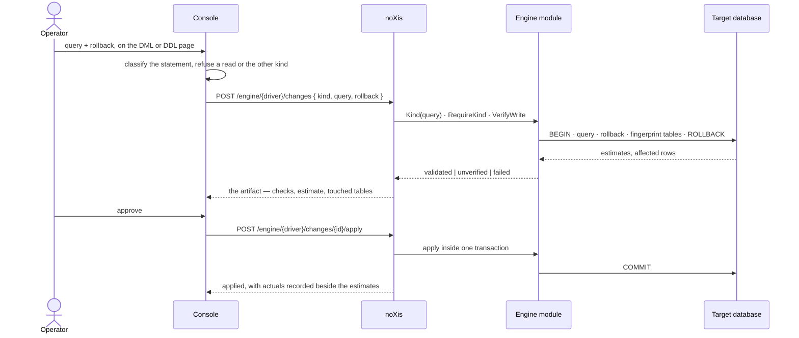

# noXis

**Selfhosted Unified Database Governance and Operations**

Browse everything you already run. Read instantly. Change it through a review that *proves* the rollback before anyone approves.

**Contents:** [What this is](#what-this-is) · [The problem](#the-problem) · [How it handles it](#how-it-handles-it) · [A change, end to end](#a-change-end-to-end) · [What makes it different](#what-makes-it-different) · [Supported databases](#supported-databases) · [Honest limits](#honest-about-limits) · [Run it](#run-it) · [Sign-in and access](#sign-in-and-access) · [Inspired by](#inspired-by) · [Contribute](#contribute)

## What this is

One Go binary with a React console baked into it, and one SQLite file for its own state. You point it at databases you already run — Postgres, MySQL, MariaDB, CockroachDB, SQLite, Redis, Valkey, Dragonfly, MongoDB, CouchDB, Elasticsearch, Meilisearch, Splunk — and it becomes the one place you look at them and the one place you change them.

No agents on your hosts. No broker. No docker socket. Your databases stay yours, and noXis asks for nothing but a connection string.

→ Architecture and layering: [docs/agent/architecture.md](docs/agent/architecture.md) · state: [docs/agent/database.md](docs/agent/database.md) · deploy: [docs/agent/infrastructure.md](docs/agent/infrastructure.md)

## The problem

You already run the databases. The hard part is *changing* them.

- "Just run this one query" — at 11pm, in production.
- A migration that looked fine right up until it wasn't.
- An admin tool that wants an agent, a broker, or root on your host just to show you a table.

Every team ends up with the same three tabs open: a browser for looking, a terminal for running, and a chat thread for asking permission. noXis is that, minus the terminal and the thread.

→ What this buys you: [How it handles it](#how-it-handles-it) · where the limits are: [Honest limits](#honest-about-limits)

## How it handles it

**Reads are instant and boring.** `SELECT`, `EXPLAIN` and `SHOW` run straight away, and the read path is read-only by construction — it refuses to become a side door for a write.

**Writes are artifacts, not keystrokes.** A change is `{connection, notes, query, rollback}` plus the kind you are raising. It is dry-run **together with its rollback** inside a transaction that always rolls back, with the referenced tables fingerprinted before and after. A rollback that leaves data changed fails, and you find out before anybody approves.

**Review is a record, not a memory.** Checks, estimates versus actuals, the tables it touched, who approved, who applied: all stored. A rejected submission is returned, not kept. A failed one is returned, not stored.

**The console is honest about what it can do.** A driver declares its capabilities; the console only offers the pages those capabilities earn. A driver that cannot do a thing is refused by name, never stubbed.

→ The rule engine per driver: [apps/api/internal/modules](apps/api/internal/modules) · the console's shape: [apps/web/src/constants/routes.ts](apps/web/src/constants/routes.ts) · why it is built this way: [docs/agent/architecture.md](docs/agent/architecture.md)

## A change, end to end



The same shape runs for a document store's write requests, where no rollback exists and the review page says so instead of pretending.

→ The full contract: [openapi.yaml](openapi.yaml) · shipped plans: [docs/plan](docs/plan)

## What makes it different

| | |
| --- | --- |
| **No sidecar** | Nothing to install next to your database. One binary, one volume, one file. |
| **The rollback is proven, not promised** | Query and rollback run together in a transaction that always rolls back, with table fingerprints to catch a rollback that changes data. |
| **Every change is an artifact** | Estimates, actuals, checks, tables, actor and trail — kept, queryable, and never silently deleted. |
| **The driver *is* the engine** | Thirteen engines behind capability interfaces, not one fat adapter. A new engine is a package and a registry entry, and the conformance suite keeps the copies honest. |
| **The console's URL is the truth** | Driver in the path, instance in the query string. No hidden selection state, so every page is linkable and every reload lands where you left off. |
| **A page you cannot use is not offered** | Capabilities come from the interfaces a module implements, so the sidebar and the pages cannot drift from what the server can actually do. |

→ Driver registry: [apps/api/internal/modules/modules.go](apps/api/internal/modules/modules.go) · capabilities: [apps/api/internal/interfaces](apps/api/internal/interfaces) · console routes: [apps/web/src/constants/routes.ts](apps/web/src/constants/routes.ts)

## Supported databases

| You run | noXis gives you |
| --- | --- |
| **Postgres** | browse, reads, validated changes, scratch-schema dry runs, ERD with estimated rows and size |
| **MySQL / MariaDB** | browse, reads, changes; unqualified DDL verifies in scratch, qualified DDL stays unverified |
| **CockroachDB** | the Postgres path over the same wire, as its own driver |
| **SQLite** | browse, reads, transactional dry runs against a file |
| **Redis / Valkey** | browse keys by pattern, inspect values with type, TTL and size, remove keys |
| **MongoDB** | explore databases, collections and documents, reviewed write requests |
| **Dragonfly** | the Redis path over its own driver |
| **CouchDB** | explore databases and documents; a write is proved in a throwaway database |
| **Elasticsearch / Meilisearch** | browse indices, run a query document, review a delete by query |
| **Splunk** | run SPL, review a delete, with the impact count the same search reports |

Redis and Valkey are separate modules under their own driver names because they are separate servers — and the acceptance suite registers a real Valkey to keep that claim honest.

→ Each engine's own rules: [apps/api/internal/modules](apps/api/internal/modules) · the acceptance matrix: [apps/api/test/uat](apps/api/test/uat)

## Honest about limits

- **MySQL commits DDL implicitly.** Unqualified DDL is copied into a scratch database; qualified DDL cannot be moved there safely and is marked `unverified` rather than pretending a dry run happened.
- **Validation samples.** A scratch mirror copies at most 100 rows per table, and DML against an empty table is `unverified` because there is no data to prove the rollback restored.
- **A cache value cannot be rolled back.** Memory cache has no change queue: browse, inspect and remove keys, and `FLUSHALL` is deliberately unreachable.
- **An interrupted apply is indeterminate.** A change claimed for execution stays `applying` after a crash; noXis will not retry it. Inspect the target before doing anything else.
- **SQLite is a file.** Point the connection at a database file on the noXis host or volume — never at noXis's own registry.
- **The registry schema is reset-only.** An older `NOXIS_DB` file is rejected with an instruction, never migrated silently. Resetting it removes stored connections, users, permissions, change history and access events.

→ Why each of these is a decision rather than a bug: [docs/agent/database.md](docs/agent/database.md) · [docs/agent/review.md](docs/agent/review.md)

## Run it

### One container

```bash
docker run -d --name noxis -p 9000:9000 \
  -v noxis-data:/data \
  -e NOXIS_SECRET_KEY="$(openssl rand -hex 32)" \
  -e NOXIS_ADMIN_EMAIL=root@example.com \
  -e NOXIS_ADMIN_PASSWORD=change-me \
  ghcr.io/dimasbaguspm/noxis:nightly
```

Open <http://localhost:9000>, sign in, register your first connection.

→ Every environment variable: [docs/agent/infrastructure.md](docs/agent/infrastructure.md#environment-variables-appsapiinternalcommonconfig) · the image build: [Dockerfile](Dockerfile)

### A seeded dev stack

One target, its seed data, and the console already logged in with that instance registered:

```bash
make dev postgres     # noxis + postgres + seed + registry, on :9000
make dev mongodb      # the same for a document store
make dev redis        # the same for a keyspace
make dev all          # every target at once
```

| Target | Brings up |
| --- | --- |
| `postgres` | Postgres 16 with the `shop` schema, customers and orders |
| `mysql` / `mariadb` | the same schema on MySQL 8 / MariaDB 11 |
| `cockroach` | CockroachDB with the same schema |
| `redis` / `valkey` | six keys: sessions with TTL, a list, a hash, a counter |
| `mongodb` | a `demo.customers` collection |
| `all` | everything above |

Bare `make dev` prints the list instead of guessing. `make dev-ui` adds the hot-reloading console on `:5173`. `make down` stops the stack and wipes its volumes.

The dev stack seeds the root super admin (`root@noxis.local` / `noxis-admin`) and registers every seeded instance, so the console opens with something to click.

→ What the stack is made of: [docker-compose.yml](docker-compose.yml) · seed scripts: [dev/seed](dev/seed) · the same stack CI runs: [docs/agent/infrastructure.md](docs/agent/infrastructure.md#docker)

### Drive it from the API

```bash
TOKEN=$(curl -s localhost:9000/external/v1/auth/login \
  -H 'Content-Type: application/json' \
  -d '{"email":"root@noxis.local","password":"noxis-admin"}' | jq -r .token)

curl -s -X POST localhost:9000/external/v1/engine/postgres/connections/demo-postgres/query \
  -H "Authorization: Bearer $TOKEN" -H 'Content-Type: application/json' \
  -d '{"sql":"SELECT 6*6 AS n"}'
```

→ The full contract: [openapi.yaml](openapi.yaml)

## Sign-in and access

Every `/external/v1/*` call needs a bearer token; there is no open mode. Local accounts sign in with an email and password (bcrypt, one opaque session token each), and the env root is the account created on first boot from `NOXIS_ADMIN_EMAIL` + `NOXIS_ADMIN_PASSWORD`. OIDC can run alongside it — a verified email that matches an account blends into that account, so the root keeps one identity whichever way it signs in.

Access is per connection — `read` < `write` < `admin`, granted to users or groups, default deny — and a super admin is the only account that manages the registry itself. Connection passwords are encrypted at rest with `NOXIS_SECRET_KEY` (`openssl rand -hex 32`) and redacted from every response.

→ Access model and the approval inbox: [docs/agent/architecture.md](docs/agent/architecture.md#auth--policy) · secrets at rest: [docs/agent/database.md](docs/agent/database.md#secrets)

## Inspired by

- **shadcn/ui and its sidebar blocks** — the console's shell, its inset panel and its primitives are the shadcn vocabulary, ported to Base UI, not reinvented.
- **pgAdmin and TablePlus** — what browsing a database should feel like: fast, keyboard-friendly, and honest about what it is showing you.
- **Rails scaffolds** — one path per action, generated and then owned, rather than a framework of options.
- **Kubernetes admission control** — the idea that a change is reviewed *before* it is admitted, and that the reviewer sees the same object the cluster will.
- **The Twelve-Factor App** — one process, configuration from the environment, and state in exactly one place.

→ The console's components: [apps/web/src/components](apps/web/src/components) · the shell: [apps/web/src/components/layout/app-shell.tsx](apps/web/src/components/layout/app-shell.tsx)

## Contribute

The loop is epic → ticket → one branch and one pull request per ticket, with the checks green before review.

→ Read [CONTRIBUTING.md](CONTRIBUTING.md) for the loop, the local checks and the conventions that bite · [AGENTS.md](AGENTS.md) for the repo map and the harness brief · [docs/agent/review.md](docs/agent/review.md) for the review checklist
