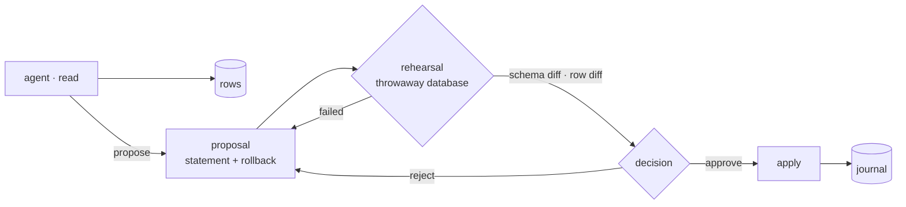
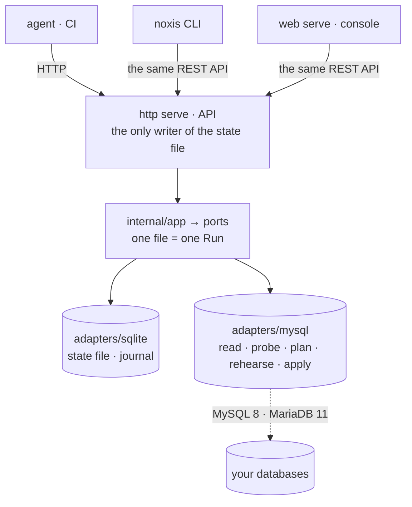

# noXis

**Reviewed database changes for agents, and the humans who answer for them.**

[](https://github.com/dimasbaguspm/noxis/actions/workflows/ci.yml)

MySQL 8 · MariaDB 11 · one binary · one SQLite file · one API

`read` scope gets rows. `propose` writes a change **and its rollback**, and gets back a rehearsal: the
schema rebuilt in a throwaway database, the diff, the rows touched, the locks taken. A human holding
`approve`/`apply` decides. Then it runs, and the receipt is kept.

```bash
docker compose up -d --build && open http://localhost:3000   # api :9000 · console :3000 · mysql :3307
```

---

## Why

| Available today | Why it fails |
| --- | --- |
| Read-only user | Safe, useless: a missing index means a human hand-writes DDL from a chat log |
| Write-capable user | The agent reviews its own work; `DROP COLUMN` on 40M rows is one typo away |
| Dry run (`BEGIN…ROLLBACK`) | MySQL/MariaDB commit DDL implicitly — nothing is proven, and `EXPLAIN` only proves it parsed |

noXis does what a reviewer does: it **executes the change somewhere else first**, and shows the diff.

## How it works

- **A change is a pair.** Statement + rollback. Kind (DDL/DML) is derived from both; a schema change
  undone by a data change is refused at proposal time.
- **Rehearsal, not dry run.** `SHOW CREATE TABLE` rebuilds the touched tables in a throwaway database,
  the change runs, the rollback runs, the schema must come back byte-identical. No `CREATE DATABASE`
  grant → the rehearsal degrades to **static** and says so; it never claims a rollback it did not run.
- **Claim before statement.** The tier recorded is the one that *ran*, not the one requested.
- **Separation of duties.** `read` · `propose` · `approve` · `apply` are separate scopes, held by
  separate tokens. An override exists and is journaled.
- **Artifacts are permanent.** Proposals are never deleted, targets are archived, the journal is
  append-only. State file schema is versioned; a mismatch refuses to open.



## Architecture



Dependency rule, enforced by `test/arch`: `cmd/* → app → ports → domain`,
`adapters/* → ports → domain`, nothing outside `cmd/` imports `cmd/`, no use case calls another,
no env read outside `internal/common/config`.

## Quick start

```bash
cp .env.example .env
# one secret per caller, and a key that seals target passwords:
openssl rand -hex 16   # paste into TOKENS, once per caller
openssl rand -hex 32   # paste into SECRET_KEY
docker compose up -d --build          # api :9000 · console :3000 · mysql :3307
```

Nothing in this repository is a working credential: there is no default token, and the API refuses to
start without one.

Register the seeded server in the console: host `mysql`, port `3306`, schema `app` (the **Test
connection** button lists it), user `noxis`, password `noxis`, TLS `skip-verify`.

```bash
make build
./bin/noxis auth signin <the ops secret you put in TOKENS> --api-url http://localhost:9000
./bin/noxis target ls
./bin/noxis query <ref> --sql "SELECT * FROM users LIMIT 5"
```

## Configuration

All environment, nothing else. `.env.example` is the full list.

| Variable | Meaning |
| --- | --- |
| `TOKENS` / `TOKENS_FILE` | `{"<name>":{"secret":"…","scopes":[…]}}` — the *name* is what the journal records |
| `SECRET_KEY` | 32 bytes hex/base64; seals target passwords (AES-256-GCM, AAD = target ref) |
| `SECRET_KEY_OLD` | comma-separated keys that no longer seal but may still open — the rotation window |
| `CONSOLE_ORIGINS` | browser origins allowed to call the API |
| `CONSOLE_HOST` / `CONSOLE_TOKEN` | API the browser should reach, and the token it gets (proved at boot) |
| `QUERY_TIMEOUT` / `PROBE_TIMEOUT` | `30s` / `5s` |
| `OTEL_EXPORTER_OTLP_ENDPOINT` | telemetry, optional — unset means nothing is exported |
| `VERSION` / `COMMIT` | stamped at build time; a plain build says `dev` with no commit |

## Self-hosting

```bash
docker run -d --name noxis --read-only -p 9000:9000 \
  -e TOKENS='{"agent":{"secret":"…","scopes":["read","propose"]}}' \
  -e SECRET_KEY=$(openssl rand -hex 32) -e CONSOLE_ORIGINS=https://console.example.com \
  -v noxisdata:/data ghcr.io/dimasbaguspm/noxis:nightly
```

- State file: `/data/noxis.db` — **back it up like a database**, it is the journal.
- Image tags on `ghcr.io/dimasbaguspm/noxis`: `nightly` and `nightly-<sha>` follow master, `v2.0.0` is
  a release, `latest` follows the newest tag (never a nightly). Both amd64 and arm64.
- The console binds **`127.0.0.1`** on purpose: it hands its token to a loopback browser. A container or
  a proxy passes `--listen 0.0.0.0`, and the token is never handed to a forwarded request.
- Upgrades migrate it: the schema is versioned and each bump is a step that runs once, in a transaction.
  A file from a *newer* build is refused rather than guessed at.
- Rotating `SECRET_KEY`: set the old key as `SECRET_KEY_OLD`, restart, re-save each password
  (`noxis instance set <ref> --password … --probe`), then drop the old key.
- One apply per instance at a time: applies take an in-process lock on the target, so two reviewers
  clicking apply queue instead of racing the DDL.
- Image: distroless, uid **65532**, read-only rootfs, its own healthcheck.
- Rehearsal grants (optional; without them the rehearsal is static):

```sql
GRANT CREATE, DROP ON *.* TO 'noxis'@'%';
GRANT ALL PRIVILEGES ON `noxis_rehearse_%`.* TO 'noxis'@'%';
```

## Use it from an agent

Capability → scope → command:

| Capability | Scope | Command |
| --- | --- | --- |
| What this token may call | any | `noxis api describe`, `noxis auth whoami`, `GET /openapi.json` |
| Instances | `read` | `target ls` · `target show <ref>` |
| Schemas, tables, one table | `read` | `table <ref>` · `table <ref> app` · `table <ref> app users` |
| Query rows | `read` | `query <ref> --sql "SELECT …"` |
| Propose DML/DDL | `propose` | `propose <ref> --title … --sql … --rollback …` |
| Re-run the proof | `propose` | `proposal rehearse <ref>` |
| Look up changes | `read` | `proposal ls --target <ref>` · `proposal show <pr>` · `proposal events <pr>` |
| Wait for a decision | `read` | `proposal watch <pr> --until applied,failed` |
| Decide | `approve` | `proposal approve <pr> --note …` · `proposal reject <pr>` |
| Apply | `apply` | `proposal apply <pr> --wait` |
| Edit a connection | `admin` | `target set <ref> --password … --probe` |
| Register / archive | `admin` | `target add …` · `target archive <ref>` |
| A route the CLI has no verb for | the token's | `api get /v1/…` · `api post /v1/… --yes` |

**First install — ask, don't assume.** The agent asks the operator before it writes a token:
which server and **schema** (MySQL calls it a database; one target = one schema), which of the five
capabilities it may hold, who holds `approve`+`apply`, and whether it may register instances at all.
One named token per caller.

Loop: `api describe → auth whoami → target ls → table → query → propose → proposal watch → report`.
`--json` on everything; failures are `{"error":{"code","message","status"}}` on stderr, non-zero exit.
`code: "client"` = the request never left the machine.

**Ready-to-copy skills** are embedded in the binary — `noxis-setup`, `noxis-read`, `noxis-propose`,
`noxis-review` — one `SKILL.md` each, in the format pi, Claude Code and Cursor load:

```bash
noxis skills                                                   # what this build carries
noxis skills noxis-read > ~/.claude/skills/noxis-read/SKILL.md # install one
```

They ship inside the binary so the skill an agent follows and the CLI that answers it are the **same
version**: a skill from a newer release describes flags this build does not have, and an agent has no way
to notice. The same four live in [`skills/`](skills/) for browsing.

## Updates

The version a build reports is the release line plus **7 characters of its commit**: `nightly+db92d5a`
(`noxis version`, console topbar, `/healthz`, `/v1/version`).

- CI `publish` runs after `go` + `web` pass on master: two binaries + `version.json` + `SHA256SUMS`
  are published to the moving **`nightly`** release.
- CI `image` builds that same commit for **amd64 + arm64** and pushes
  `ghcr.io/dimasbaguspm/noxis:nightly` and `:nightly-<sha>`; a `v*` tag pushes `:<tag>` and `:latest`.
- The **server** fetches `…/releases/download/nightly/version.json` at most once an hour;
  `GET /v1/version` answers `{version, commit, release_url, latest, newer}`.
- The check runs on boot: one line on stderr for the CLI, and in the console a chip in the top bar naming
  this build with an **Upgrade to latest** button beside it when there is somewhere to move to. Nothing
  installs itself — every notice points at **https://github.com/dimasbaguspm/noxis/releases**.

Cut a release: tag `v2.0.0` → CI publishes the image as `v2.0.0` and moves `latest`, and you publish the
same three assets from that tag as a non-prerelease. Nightly keeps moving; a tag never does.

## Develop

```bash
make test     # unit + layering test          (~5s)
make lint     # golangci-lint v2              (~30s)
make uat      # godog over a real process     (~20s)
make cover    # per-package floors, a ratchet
make spec     # regenerate OpenAPI (committed)
make web      # build the console into the binary
pnpm -C web check && pnpm -C web test
```

Flow: **epic → tickets → one PR per ticket**, CI green (`go`, `web`, `publish`) before review, human
merges. Read `AGENTS.md` for the map, `docs/agent/` for the detail.

Layout: `cmd/noxis/{http,commands,web}` · `internal/{domain,ports,app,adapters,client,common,constants}` ·
`web/` · `test/{arch,uat,coverage}`.

## License

MIT — see [LICENSE](LICENSE).
