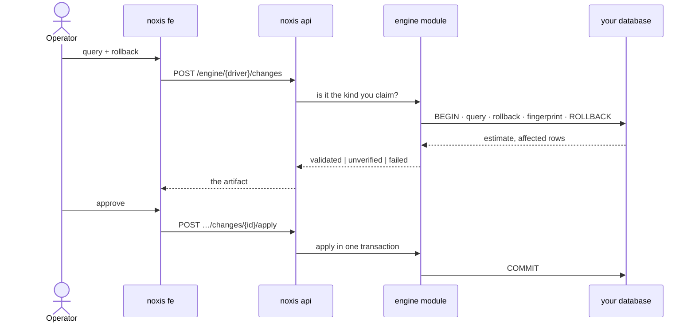

# noXis

**Selfhosted Unified Database Governance and Operations**

Browse everything you already run. Read instantly. Change it through a review that proves the rollback before anyone approves.

## What this is

Two pieces and one file. **noxis api** is a Go binary that talks to your engines and keeps its own state in a SQLite file. **noxis fe** is the console that binary serves.

You point it at databases you already run, and it becomes the one place you look at them and the one place you change them. No agents on your hosts. No broker. No docker socket. Your databases stay yours, and noXis asks for nothing but a connection string.

## The problem

You already run the databases. The hard part is *changing* them.

- "Just run this one query" — at 11pm, in production.
- A migration that looked fine right up until it wasn't.
- An admin tool that wants an agent, a broker, or root on your host just to show you a table.

Every team ends up with the same three tabs open: a browser for looking, a terminal for running, and a chat thread for asking permission. noXis is that, minus the terminal and the thread.

## How it works

**Reading is boring on purpose.** `SELECT`, `EXPLAIN` and `SHOW` come back immediately. The read route is read-only by construction — it refuses to become a side door for a write.

**Writing is a form, not a keystroke.** A change is the query, the rollback you promise, and a note saying why. You submit it. You don't run it.

**The dry run is the whole idea.** noxis api runs your query and then your rollback inside one transaction that always ends in `ROLLBACK`, with the referenced tables fingerprinted before and after. If the rollback leaves data changed, the change fails right there — before a reviewer ever sees it.

**Review leaves a receipt.** The checks, the estimate next to the actual, the tables it touched, who approved it, who applied it. All stored, all queryable, none of it deleted.

**noxis fe shows only what noxis api can do.** Each engine declares what it supports, and the console offers only the pages those capabilities earn. An engine that can't do a thing says so by name instead of offering a button that fails.



## What makes it different

| | |
| --- | --- |
| **The rollback is proven, not promised** | Query and rollback run together in a transaction that always rolls back, and table fingerprints catch a rollback that quietly changes data. |
| **Every change is an artifact** | Estimate, actual, checks, tables, approver, applier — kept and queryable. A failed submission is returned, a rejected one is never stored. |
| **No sidecar** | Nothing to install beside your database. One binary, one volume, one file. |
| **The engine *is* the adapter** | Thirteen engines behind capability interfaces, not one fat adapter with thirteen branches. Adding one is a package and a registry entry. |
| **A page you can't use isn't offered** | The sidebar comes from the interfaces a module implements, so the console cannot drift from what the server can actually do. |

## Supported databases

| Family | Engines | What you get |
| --- | --- | --- |
| **SQL** | Postgres, CockroachDB, MySQL, MariaDB, SQLite | browse, read, validated changes, an ERD of keys and foreign keys |
| **Cache** | Redis, Valkey, Dragonfly | keys by pattern, values with type and TTL, remove a key or empty a database |
| **Document** | MongoDB, CouchDB | databases, collections, documents, reviewed writes |
| **Search** | Elasticsearch, Meilisearch, Splunk | indices, queries, reviewed deletes |

Redis, Valkey and Dragonfly are separate modules under separate driver names because they are separate servers — the acceptance suite registers all three to keep that claim honest.

## Honest limits

**Not built yet.**

- **A cache value is read-only.** Browse, inspect, remove a key, or empty a database behind a typed confirmation. You cannot *set* a value, and there is no change queue for a cache because there is no transaction to prove.
- **MongoDB writes have no validated rollback.** They still go through review; the review page says the rollback is unproven instead of pretending.
- **No backup, restore, or maintenance jobs.** noXis governs changes to your data and schema, not your backups.
- **One change, one connection.** No cross-database joins or copies.

**Can't be done honestly.**

- **MySQL and MariaDB commit DDL implicitly.** Unqualified DDL is copied into a scratch database and proved there. Qualified DDL cannot be moved safely, so it is marked `unverified` rather than pretending a dry run happened.
- **A cache value cannot be rolled back.** There is nothing to undo, so nothing is promised.
- **A delete-by-query has no rows to preview.** The impact is a count from the same search.

**Things that will surprise you.**

- **Validation samples.** A scratch mirror copies at most 100 rows per table, and DML against an empty table stays `unverified` — there is no data to prove the rollback restored.
- **An interrupted apply is indeterminate.** A change claimed for execution stays `applying` after a crash, and noXis will not retry it. Look at the target before doing anything else.
- **The registry is reset-only.** An older `NOXIS_DB` file is rejected with an instruction rather than migrated, and resetting it drops connections, users, permissions, change history and access events.

## Run it

One container:

```bash
docker run -d --name noxis -p 9000:9000 \
  -v noxis-data:/data \
  -e NOXIS_SECRET_KEY="$(openssl rand -hex 32)" \
  -e NOXIS_ADMIN_EMAIL=root@example.com \
  -e NOXIS_ADMIN_PASSWORD=change-me \
  ghcr.io/dimasbaguspm/noxis:nightly
```

Open <http://localhost:9000>, sign in, add your first connection.

Or bring up a whole seeded stack — noxis plus real targets, already registered in the console:

```bash
make dev postgres     # noxis + a seeded Postgres, on :9000
make dev all          # every target at once
```

Sign in as `root@noxis.local` / `noxis-admin` and the instances are already there.

Building from source, hot-reloading the console and the full check list: [CONTRIBUTING.md](CONTRIBUTING.md).

## Inspired by

- **pgAdmin** — browsing an engine you already run, without installing anything on the host that runs it.
- **Bytebase** — a schema change is a reviewed object with a record, not a command someone pasted at 11pm.
- **TablePlus** — one window for every engine, and a UI that gets out of the way.

## Contribute

The loop is epic → ticket → one branch and one pull request per ticket, with the checks green before review. [CONTRIBUTING.md](CONTRIBUTING.md) has the loop, the local checks and the conventions that bite.
