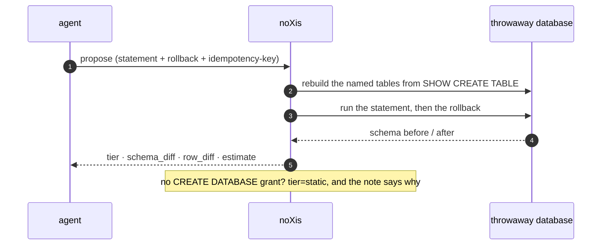

# noXis propose

A proposal is a **pair**: the statement, and the statement that undoes it. `propose` scope can create
proposals and re-run rehearsals. It cannot approve or apply anything — that is the point.



## 1. Read first

```bash
noxis target show <ref> --json      # is this the right instance and schema?
noxis table <ref> app users --json  # columns, indexes, and the engine's own DDL
noxis query <ref> --sql "SELECT COUNT(*) FROM users WHERE …"
noxis proposals --target <ref>      # is this change already queued or applied?
```

Never write DDL against a table you have not looked at. The `create_sql` in `table` is exactly what the
rehearsal will rebuild.

## 2. Write the pair

```bash
noxis propose <ref> \
  --title "add users.active" \
  --sql "ALTER TABLE users ADD COLUMN active TINYINT(1) NOT NULL DEFAULT 0" \
  --rollback "ALTER TABLE users DROP COLUMN active" \
  --note "filtering inactive accounts; no backfill needed" \
  --idempotency-key add-users-active-2026-11-21 \
  --json
```

- **The rollback is mandatory in practice.** A DDL change without one is irreversible, and `apply` will
  demand an explicit acknowledgement of that. Write it.
- **The kinds must match.** A schema change is undone by a schema change, a data change by a data change.
  A statement and its rollback of different kinds is refused at proposal time — that is a bug in your
  proposal, not a limit of the tool.
- **The same `--idempotency-key` makes a retry the same proposal.** Always pass one when a network failure
  could make you unsure whether the first call landed.
- `--tier static|shadow|rehearsal` (default `shadow`). Leave it alone unless the operator asked — with one
  exception. A change that **creates** its subject (`CREATE TABLE`, or an index on a table this change
  makes) has no table to rebuild, so the rehearsal fails with `Table … doesn't exist`. Propose a bootstrap
  with `--tier static` and say why in the note: there is nothing to rehearse until the table exists.
- `--file` / `--rollback-file` for long statements.

## 3. Read the rehearsal, do not skim it

The answer carries the rehearsal: tier, note, duration, `schema_diff`, `row_diff`, locks and the plan.

| Tier | What it proves |
| --- | --- |
| `rehearsal` / `shadow` | the change ran in a throwaway database rebuilt from `SHOW CREATE TABLE`, the rollback ran too, and the schema came back identical |
| `static` | nothing ran: parse + `EXPLAIN` + row estimate. The note names the engine error and the grant that would restore the real rehearsal. **It never claims the rollback works.** |
| `failed` | the statement did not survive the rehearsal. Read `error` and `note`; the proposal is stored, fix the SQL and propose again |

The tier a proposal carries is the one that **ran**, not the one you asked for. If you see `static` and the
change is destructive, say so to the reviewer instead of presenting it as proven.

## 4. Report

Quote, in your answer to the reviewer: the tier, the schema diff (or "no schema change"), the rows the
diff touches, and the estimate. Then hand it over — the decision is not yours.

```bash
noxis show-proposal <pr> --json      # everything the reviewer will read
noxis watch <pr> --until approved,rejected,applied,failed --timeout 30m
```

Waiting is `read` scope: an agent may follow its own proposal to its ending without being able to decide it.

## When it is refused

| Answer | Meaning | Do |
| --- | --- | --- |
| `unsupported: the statement names schema "x", and this target governs "y"` | the change reaches outside the governed schema | a cross-schema change is not a proposal — register another target for that schema |
| `invalid` + "the change is ddl and the rollback is dml" | the pair does not undo itself | rewrite the rollback |
| `conflict` | the proposal is not in a state that allows this step | re-read it with `show-proposal` |
| rehearsal `failed` | the SQL did not survive | read `error`, fix, propose again with a **new** idempotency key |
| rehearsal `static` | the server would not let it build a database | report it; the change is unproven |

## Never

- Never propose `DROP`, `TRUNCATE` or a `DELETE` without a `WHERE` clause unless the operator asked for
  exactly that, in writing.
- Never propose a statement you have not rehearsed, and never describe a `static` proposal as proven.
- Never approve or apply your own proposal, even if a token would let you.
- Never re-post a `propose` without its idempotency key after a timeout: two proposals for one change is
  two reviews for one change.
